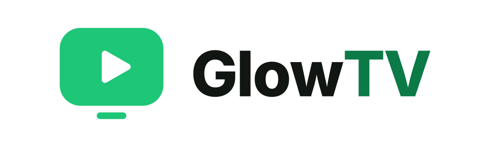
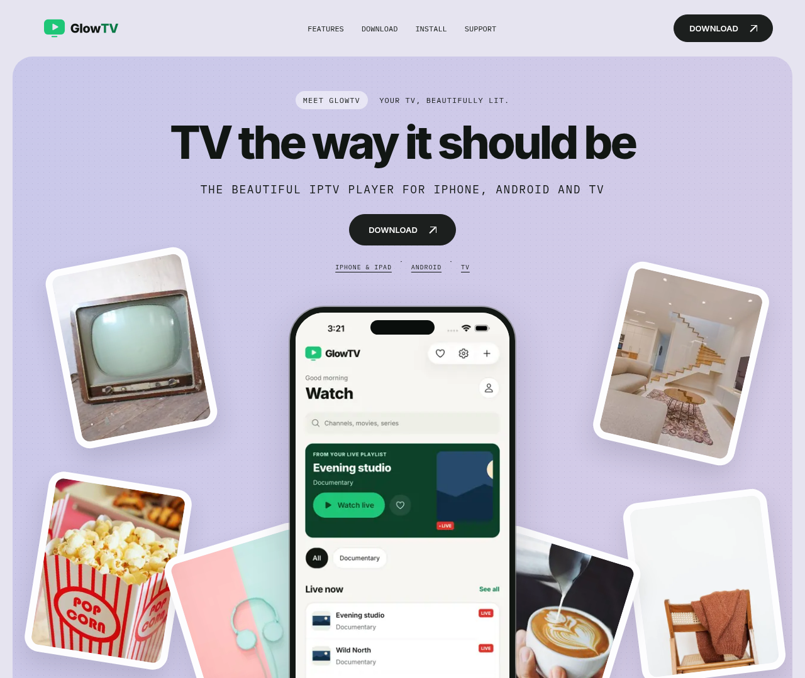

<p align="center"><picture><source media="(prefers-color-scheme: dark)" srcset="brand/logo/glowtv-logo-dark-bg.svg" /></picture></p>

# GlowTV

**Your TV, beautifully lit.** A free, open-source IPTV player for iPhone, iPad, Android, Android TV and Fire TV. Bring your own legally obtained M3U playlist, file or Xtream Codes account. GlowTV does not sell, host or provide channels, subscriptions or content.

[Website](https://glowtv.app/) · [Download availability](https://glowtv.app/download/) · [Installation guides](https://glowtv.app/install/) · [Support](https://glowtv.app/support/) · [Changelog](CHANGELOG.md)

GlowTV 0.7.3 is available for iPhone/iPad, Android phone and Android TV/Fire TV. The IPA needs personal signing; Android APKs install directly. Store listings are pending. See [hosting instructions](website/HOSTING.md) for the website domain.

[](https://glowtv.app/)

<!-- downloads:start -->
| Your device | Direct GitHub download | Setup and features | Project |
| --- | --- | --- | --- |
| iPhone / iPad | [IPA · 0.7.3](https://github.com/nhshajib/NodeCast/releases/download/ios-v0.7.3/GlowTV-0.7.3-unsigned.ipa) | [Download details](https://glowtv.app/download/iphone/) · [Instructions](apps/player/iphone/README.md) | [iPhone / iPad project](apps/player/iphone/) |
| Android phone | [APK · 0.7.3](https://github.com/nhshajib/NodeCast/releases/download/glowtv-android-v0.7.3/GlowTV.apk) | [Download details](https://glowtv.app/download/android/) · [Instructions](apps/player/android-mobile/README.md) | [Android phone project](apps/player/android-mobile/) |
| Android TV / Fire TV | [TV APK · 0.7.3](https://github.com/nhshajib/NodeCast/releases/download/glowtv-android-v0.7.3/GlowTV-TV.apk) | [Download details](https://glowtv.app/download/tv/) · [Instructions](apps/player/android-tv/README.md) | [Android TV / Fire TV project](apps/player/android-tv/) |
<!-- downloads:end -->

[0.7.2 UI audit and before/after code](docs/UI-UX-AUDIT-0.7.2.md) · [Design tokens](apps/player/src/designTokens.ts)

Apple TV is not supported yet. Apple TV brand assets are prepared for a future tvOS project.

## Features

Live TV and XMLTV guide, provider-supported catch-up, movies, series and next episode, favorites, search, multiple profiles, viewing progress, encrypted backup and transfer, family controls, external players, on-screen playback settings and a dedicated remote-first TV layout. Compatible native iOS playback supports AirPlay and picture-in-picture; Chromecast is not implemented.

## Projects

- [apps/player/](apps/player/) — one shared React Native + Expo project with phone and dedicated TV shells.
- [website/](website/) — independent Astro static site; no dependency on the app project.
- [brand/](brand/) — original supplied GlowTV logos, launcher icons and brand board.
- [design/](design/) — supplied app mockups and website reference.
- [store-assets/](store-assets/) — screenshot candidates, icons and capture provenance.

## Run locally

Use Node.js 24 LTS. From the repository root:

```sh
cd apps/player
npm ci
npm run typecheck
npm test
npm run start:dev
```

On Windows PowerShell, use `npm.cmd` and `npx.cmd` if script execution is restricted. Expo Go can preview supported features; built-in VLC needs a custom native build. Existing bundle IDs, signing configuration, backup formats and persisted storage keys are retained for update compatibility.

For the website, open another terminal:

```sh
cd website
npm ci
npm run dev
```

[Build and hosting](website/HOSTING.md) · [Audit scope](verification/glowtv/README.md) · [Original project attribution](NOTICE) · [GPL-3.0-only license](LICENSE)

Optional support: [buymeacoffee.com/hexorbd](https://buymeacoffee.com/hexorbd). Support never unlocks content or app features.
