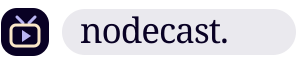
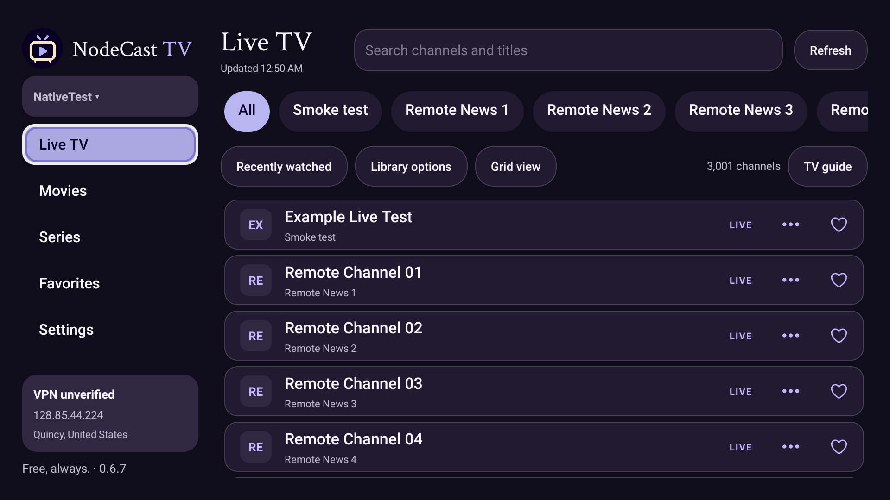
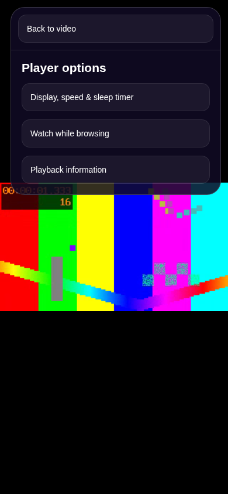
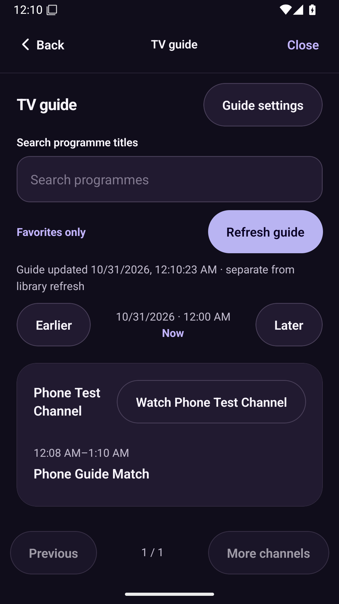

  

  <a href="#download"><strong>Download</strong></a> &nbsp; / &nbsp;
  <a href="#a-look-inside">A look inside</a> &nbsp; / &nbsp;
  <a href="#made-for-your-everyday-watching">Features</a> &nbsp; / &nbsp;
  <a href="#a-little-help">Help</a> &nbsp; / &nbsp;
  <a href="https://buymeacoffee.com/hexorbd">Support</a>

<a href="#download">
<picture>
  <source media="(max-width: 600px)" srcset="assets/readme/hero-mobile.svg" />
  
</picture>
</a>

  Bring your <strong>Xtream Codes server or M3U playlist</strong>. 
  Keep your profiles on your device. Make yourself at home.

 

## Download

### Three screens. Find your fit.

The same free player, with an interface made for each device. **Current release: 0.6.7.**

<table>
<tr>
<td width="30%" align="center" valign="middle"></td>
<td width="70%" valign="top">
<h3>iPhone</h3>

IPA · 35.8 MB · v0.6.7

Your playlists, wherever the day takes you. Sign with Impactor; free Apple signing normally renews every seven days.

<a href="iphone/README.md#install-on-windows">Installation guide</a> · <a href="iphone/CHANGELOG.md">What's new</a>

</td>
</tr>
<tr>
<td width="30%" align="center" valign="middle"></td>
<td width="70%" valign="top">
<h3>Android mobile</h3>

APK · 225.1 MB · v0.6.7

For phones and tablets running Android 7+. Install once, with no weekly signing renewal.

<a href="android-mobile/README.md#install">Installation guide</a> · <a href="android-mobile/CHANGELOG.md">What's new</a>

</td>
</tr>
<tr>
<td width="30%" align="center" valign="middle"></td>
<td width="70%" valign="top">
<h3>Fire TV &amp; Android TV</h3>

TV APK · 223.8 MB · v0.6.7

A dedicated landscape interface for your remote. Android 7+, with no weekly signing renewal.

<a href="android-tv/README.md#install">Installation guide</a> · <a href="android-tv/CHANGELOG.md">What's new</a>

</td>
</tr>
</table>

> **Downloading from this private repository?** Sign into a GitHub account with access first. [Download help →](docs/DOWNLOADS.md)

Installed apps run independently of Expo Go and your PC. Update over the existing app with the same signing identity to retain profiles. [Build details & checksums →](verification/android/native-0.6.7-builds.json)

 

## A look inside

### A small screen. A big-screen evening.

Your library takes center stage. Clear navigation, familiar controls and room to breathe.

<strong>Stay in. Settle in.</strong> A compact channel list and controls built for your remote.

<strong>Take a closer look at the mobile player</strong>

 

  
  

Actual app captures: mobile browser preview and Android mobile/TV emulators. Provider content is synthetic; the TV connection card belongs to the disposable test runner. The hero and device cards are illustrations. [More TV screenshots →](verification/tv-library/README.md)

 

## Made for your everyday watching

<table>
<tr>
<td width="50%" valign="top">
<h3>Your playlists, together.</h3>

Connect Xtream Codes or an M3U link. Keep separate profiles, find a channel, and save the ones you return to.

</td>
<td width="50%" valign="top">
<h3>Keep the moment playing.</h3>

Adjust playback in a compact translucent panel over the video. Controls fade away when you settle back into watching.

</td>
</tr>
<tr>
<td valign="top">
<h3>A little more control.</h3>

Choose your appearance, organize categories and favorites, and use optional local family controls. Clear recents while keeping viewing progress.

</td>
<td valign="top">
<h3>Your setup goes with you.</h3>

Move profiles, server details, favorites and settings with a password-encrypted backup. No NodeCast sign-in is required.

</td>
</tr>
</table>

[Explore features and availability →](verification/roadmap/README.md) &nbsp; · &nbsp; [How backup & transfer works →](verification/transfer/README.md)

 

## A better evening on TV

**New in 0.6.7:** channels open in a lightweight text list, with optional grid view and logos. Library organization separates preferences, categories and favorite order. Saved categories restore after restarting, and unopened media libraries wait until you need them.

Playback settings stay over the video across all three editions, so you can adjust things without leaving what you are watching.

[Read the release notes →](CHANGELOG.md) &nbsp; · &nbsp; [See the TV edition →](android-tv/README.md) &nbsp; · &nbsp; [Verification →](verification/RESULTS.md)

 

## From download to your first channel

1. **Pick your screen.** Download the matching edition and follow its installation guide.
2. **Bring your playlist.** Add the server details or complete M3U link supplied by your provider.
3. **Make it yours.** Save favorites, arrange categories and press play.

NodeCast is a **media player**. It does not provide channels, playlists or subscriptions. Bring your own authorized content source.

 

## A little help

<strong>Is NodeCast really free?</strong>

Yes. The app is free, and supporting the project is optional. An iPhone's personal signing and renewal requirements still apply; Android APKs do not need weekly renewal.

<strong>Do I need to keep my PC running?</strong>

No. The installed IPA/APK runs on your device without a development PC or Expo Go. With free Apple signing, the iPhone app normally needs re-signing every seven days. [iPhone installation and renewal →](iphone/README.md)

<strong>Which version should I install on Fire TV?</strong>

Choose the **Fire TV / Android TV APK**. It has a landscape library and remote navigation. The Android mobile APK is for touch devices. [TV installation guide →](android-tv/README.md)

<strong>The download fails, or a channel won't play.</strong>

If the download asks you to log in or returns 404, sign into a GitHub account with repository access. For streams, verify your provider details and connection first. [Download and playback help →](docs/DOWNLOADS.md)

<strong>Can it tell whether my VPN is connected?</strong>

The Home connection card shows your public IP and approximate location. An optional home-IP reference helps you recognize your usual connection. A different IP does not confirm a VPN; VPN status remains unverified.

<strong>Where are release history and technical details?</strong>

[Version history](CHANGELOG.md) is also available inside the app under **Settings → Version history**. Each edition's page links to its build record and checksum. See [verification](verification/RESULTS.md) for automated/native checks and their limits; physical-device performance and real-provider compatibility still need confirmation.

 

---

  <strong>Good evenings, made a little better.</strong> 
  NodeCast is free. If it earns a spot on your home screen, a little support is appreciated.

  <a href="https://buymeacoffee.com/hexorbd"><strong>Buy me a coffee</strong></a> 
  Always optional. No features locked behind a donation.

  <a href="docs/DEVELOPMENT.md">Build &amp; contribute</a> &nbsp; · &nbsp;
  <a href="CHANGELOG.md">Version history</a> &nbsp; · &nbsp;
  <a href="LICENSE">GPL-3.0 license</a> &nbsp; · &nbsp;
  <a href="NOTICE">Project notices</a> &nbsp; · &nbsp;
  <a href="THIRD_PARTY_NOTICES.md">Third-party notices</a>

