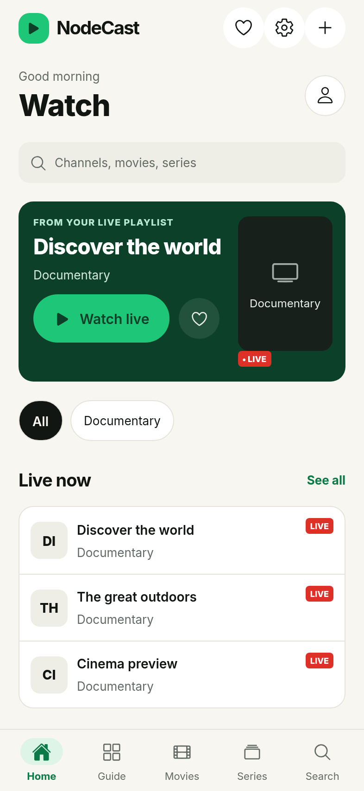
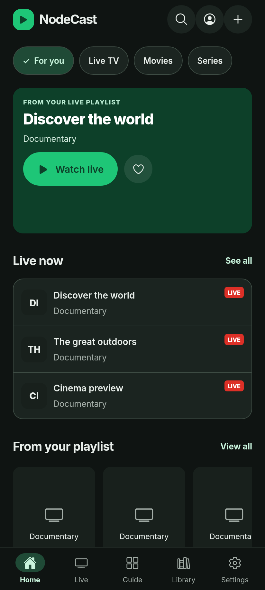
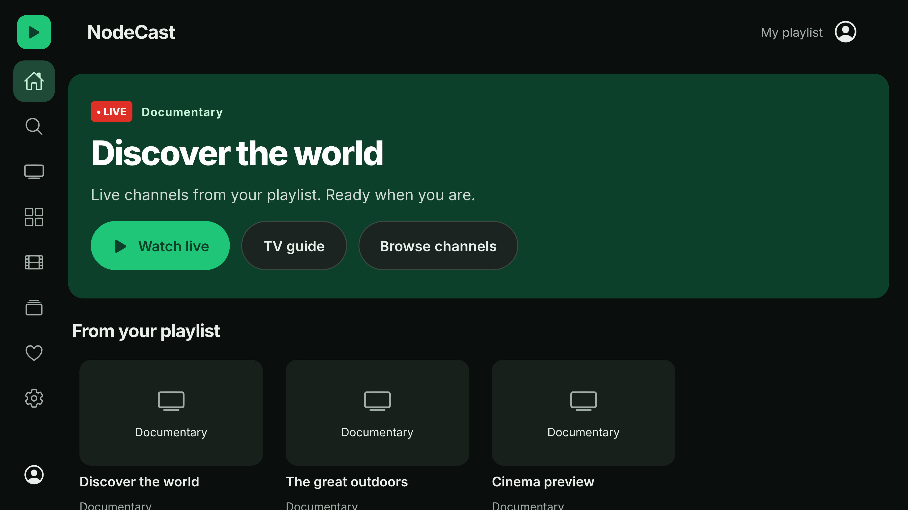
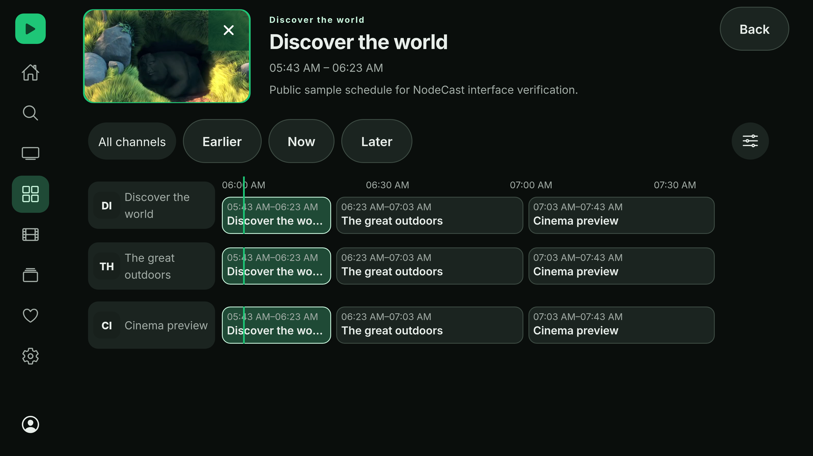

<p align="center"><a href="https://nhshajib.github.io/NodeCast/"></a></p>
<h1 align="center">Your playlists. Every screen.</h1>
<p align="center">A free, open-source IPTV player for iPhone, Android phones, Fire TV and Android TV.<br>Bring your own M3U link, Xtream Codes server or playlist file.</p>
<p align="center"><a href="https://nhshajib.github.io/NodeCast/"><strong>Explore the website →</strong></a> &nbsp; · &nbsp; <a href="#downloads">Downloads</a> &nbsp; · &nbsp; <a href="#a-look-inside">Screenshots</a> &nbsp; · &nbsp; <a href="CHANGELOG.md">Changelog</a> &nbsp; · &nbsp; <a href="https://buymeacoffee.com/hexorbd">Support</a></p>

## A look inside

The upcoming **0.7.0 design** brings warm iPhone surfaces, dark Android screens and a TV interface built for the remote. Native compilation is deferred while further work continues. **Current public downloads remain 0.6.7 and use the previous design.**

<table><tr><td width="25%"></td><td width="25%"></td><td width="50%"><br></td></tr></table>

[View every screen on the website →](https://nhshajib.github.io/NodeCast/#screens) · [Design audit and capture provenance →](verification/leaf-design/README.md)

## Downloads

| Product | Current public download | Install | Version history |
| --- | --- | --- | --- |
| iPhone | [Download unsigned IPA](https://github.com/nhshajib/NodeCast/releases/download/ios-v0.6.7/NodeCast-0.6.7-unsigned.ipa) | [Windows / Impactor](iphone/README.md#install-on-windows) | [iPhone changelog](iphone/CHANGELOG.md) |
| Android phone / tablet | [Download phone APK](https://github.com/nhshajib/NodeCast/releases/download/android-v0.6.7/NodeCast-mobile-0.6.7.apk) | [Android instructions](android-mobile/README.md#install) | [Android changelog](android-mobile/CHANGELOG.md) |
| Fire TV / Android TV | [Download TV APK](https://github.com/nhshajib/NodeCast/releases/download/android-v0.6.7/NodeCast-tv-0.6.7.apk) | [TV instructions](android-tv/README.md#install) | [TV changelog](android-tv/CHANGELOG.md) |

Installed apps run independently of Expo Go and your computer. Free Apple signing normally needs renewal every seven days. Android installations do not require weekly signing. Keep the same signing identity when updating to retain local app data.

## Made for your everyday watching

- **Your sources:** multiple profiles, M3U links and files, Xtream Codes, per-provider advanced headers, refresh and cached libraries.
- **Your library:** live TV, movies, seasons and episodes, favorites, search, category organization, recents and resume progress.
- **Your guide:** XMLTV import, local schedules, channel mapping, now/next and catch-up when supported by your provider.
- **Your player:** native and VLC playback engines, external players, audio/subtitle selection, display fit, speed, sleep timer and next episode. Capabilities depend on engine and stream.
- **Your device:** local secure profiles, encrypted backup/import, family controls, home-IP comparison and connection details. An IP comparison does not prove VPN status.
- **Your TV:** a dedicated landscape application with D-pad navigation and remote-accessible playback controls.

NodeCast includes no channels or subscriptions. It is a media player for content you supply. There is no player subscription or sign-up requirement. [Optional support is appreciated.](https://buymeacoffee.com/hexorbd)

## Develop

```bash
npm ci
npm run typecheck
npm test
npm start
```

[Windows start guide](START-HERE-WINDOWS.md) · [Development builds](docs/DEVELOPMENT.md) · [Native builds](docs/NATIVE-BUILDS.md) · [Transition configuration](docs/TRANSITIONS.md) · [Playback compatibility](docs/LIVE-TV-COMPATIBILITY.md)

## License and attribution

GPL-3.0-only. NodeCast is based on [technomancer702/nodecast-tv](https://github.com/technomancer702/nodecast-tv). See [LICENSE](LICENSE), [NOTICE](NOTICE) and [third-party notices](THIRD_PARTY_NOTICES.md). Inter is distributed under the SIL Open Font License. Screenshots use test playlists and public Blender sample content; no IPTV service is supplied or endorsed.
