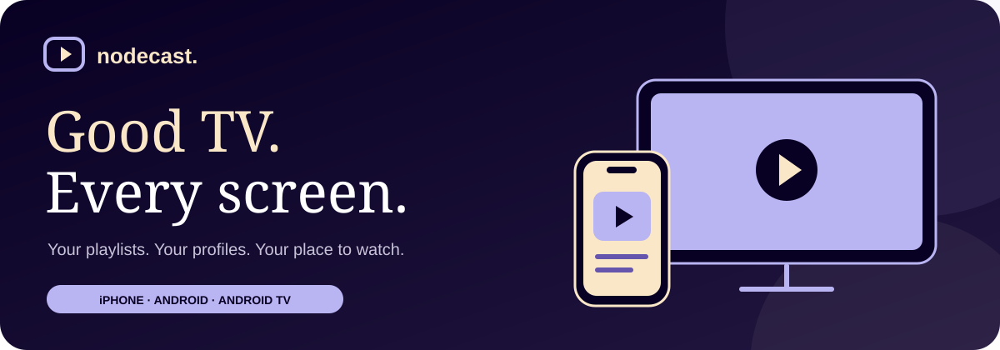

  

  <strong>Free IPTV player. Three editions. Your own TV space.</strong> 
  Bring your Xtream Codes server or M3U playlist. Save your profiles locally and watch with built-in playback.

  <a href="#choose-your-edition">Choose your edition</a> ·
  <a href="CHANGELOG.md">What's new</a> ·
  <a href="docs/DOWNLOADS.md">Download help</a> ·
  <a href="docs/DEVELOPMENT.md">For developers</a> ·
  <a href="https://buymeacoffee.com/hexorbd">Support NodeCast</a>

## Choose your edition

<table>
<tr>
<td width="33%" valign="top" align="center">

<strong>iPhone</strong> 0.6.7 · IPA

<a href="iphone/README.md"><strong>Download &amp; install →</strong></a>

<a href="iphone/CHANGELOG.md">Changelog</a> · <a href="iphone/build.json">Build details</a>

</td>
<td width="33%" valign="top" align="center">

<strong>Android</strong> 0.6.7 · APK

<a href="android-mobile/README.md"><strong>Download &amp; install →</strong></a>

<a href="android-mobile/CHANGELOG.md">Changelog</a> · <a href="android-mobile/build.json">Build details</a>

</td>
<td width="33%" valign="top" align="center">

<strong>Fire TV / Android TV</strong> 0.6.7 · APK

<a href="android-tv/README.md"><strong>Download &amp; install →</strong></a>

<a href="android-tv/CHANGELOG.md">Changelog</a> · <a href="android-tv/build.json">Build details</a>

</td>
</tr>
</table>

Each edition has its own published version. While this repository is private, **sign into a GitHub account with repository access before downloading**.

## Settle in. Press play.

| Your library | Your connection | Your screen |
| --- | --- | --- |
| Xtream Codes and M3U links | Local profiles and saved server details | Built-in VLC for live TV |
| Live channels, films and provider series | Public IP and approximate location | Native movie and episode playback |
| Search, categories and favorites | Optional home-IP reference | TV remote navigation and Next episode |

Installed IPA/APK builds run independently of Expo Go and a development PC. iPhone personal signing has its own renewal requirements; Android APKs have no weekly renewal. The IP comparison helps identify your home connection; VPN status remains unverified.

### New for Fire TV and Android TV

TV 0.6.7 defaults to a compact channel list, skips logos unless enabled, and loads unopened media libraries only when needed. Library organization separates preferences, categories and favorites, restores saved categories after restarting, and keeps media-specific settings clear. [TV download and details →](android-tv/README.md) · [Checks and screenshots →](verification/tv-library/README.md)

The library changes are TV-only. All three editions get translucent onscreen playback settings and auto-hiding controls. Provider-supported Xtream catch-up remains inside completed guide programme details.

### Available across all three editions

**Playback settings** open over the video in a compact translucent panel. Controls hide after four idle seconds; settings close after eight. Unsaved edits, paused playback and screen readers keep controls available. [Playback overlay details →](verification/playback-overlay/README.md)

**Clear recents** keeps viewing progress. **Settings → Backup & transfer** moves profiles, server details, favorites and settings with a password-encrypted file. [How transfer works →](verification/transfer/README.md)

Full TV guides, a persistent mini-player, **Light / Dark / Follow device**, and optional local family controls. Sorting and refresh stay in Library options; display, speed and sleep stay in the player menu. [Feature details and limits →](verification/roadmap/README.md)

[See the TV library →](verification/tv-library/tv-channel-list.png) · [Read the Android TV guide →](android-tv/README.md)

## Downloads at a glance

| Edition | Version | Download | Renewal |
| --- | --- | --- | --- |
| [iPhone](iphone/README.md) | **0.6.7** | [IPA ↓](https://github.com/nhshajib/NodeCast/releases/download/ios-v0.6.7/NodeCast-0.6.7-unsigned.ipa) | Normally 7 days with free Apple signing |
| [Android mobile](android-mobile/README.md) | **0.6.7** | [APK ↓](https://github.com/nhshajib/NodeCast/releases/download/android-v0.6.7/NodeCast-mobile-0.6.7.apk) | No weekly renewal |
| [Fire TV / Android TV](android-tv/README.md) | **0.6.7** | [TV APK ↓](https://github.com/nhshajib/NodeCast/releases/download/android-v0.6.7/NodeCast-tv-0.6.7.apk) | No weekly renewal |

These are personal testing releases. Android uses the standard Android test signing key; the iPhone IPA needs personal signing. Install updates over the existing app with the same signing identity to preserve local profiles. Use **Settings → Backup & transfer** to save a password-encrypted copy of your setup before changing devices.

## Need a hand?

- **First installation:** choose a product above for device-specific steps.
- **Download opens a login page or gives 404:** [Download help](docs/DOWNLOADS.md).
- **App opens but a stream will not play:** [Playback help](docs/DOWNLOADS.md#the-app-opens-but-a-stream-will-not-play).
- **Want version history:** [All editions](CHANGELOG.md), or **Settings → Version history** inside the app.
- **Want to build or contribute:** [Developer guide](docs/DEVELOPMENT.md) · [Native builds](docs/NATIVE-BUILDS.md) · [Verification](verification/RESULTS.md).

## Free, with a little support

NodeCast is free. If it makes your evenings better, [buy me a coffee](https://buymeacoffee.com/hexorbd). Support is appreciated, always optional, and unlocks no extra features.

[GPL-3.0 license](LICENSE) · [Project notices](NOTICE) · [Third-party notices](THIRD_PARTY_NOTICES.md)
