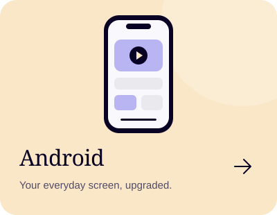
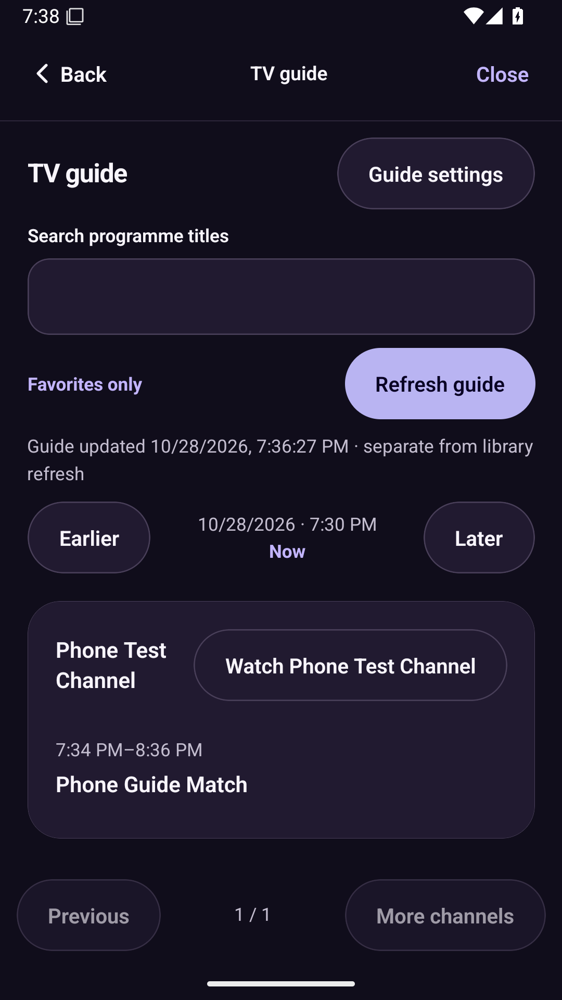

[← All editions](../README.md) · [iPhone](../iphone/README.md) · [Other Android edition](../android-tv/README.md)

# NodeCast for Android mobile

Phone and tablet layouts with local profiles, search, favorites and built-in playback.

**[Download APK · 0.6.0](https://github.com/nhshajib/NodeCast/releases/download/android-v0.6.0/NodeCast-mobile-0.6.0.apk)** · [Release page](https://github.com/nhshajib/NodeCast/releases/tag/android-v0.6.0) · [Changelog](CHANGELOG.md) · [Build details & checksum](build.json)

While this repository is private, sign into GitHub with repository access before downloading.

## Version at a glance

| | Current download |
| --- | --- |
| Version | **0.6.0** · October 28, 2026 |
| File | `NodeCast-mobile-0.6.0.apk` · 225.1 MB |
| Compatibility | Android 7+ · ARM32, ARM64 and x86-64 |
| App ID | `com.nhshajib.nodecast` |
| Signing | Signed personal-testing APK · standard Android test key |
| Watching | No Expo Go, running PC or weekly signing renewal |
| Profiles | Local storage; no account or cloud sync |

## New in 0.6.0

Full XMLTV guides, local family controls, Light/Dark/System, persistent mini-player, display/speed/sleep tools, local M3U import and library preferences. [Details and limits](../verification/roadmap/README.md).

Preview the mobile interface

 

Native Android emulator capture.

## Install

1. Open this page on your Android phone/tablet and sign into GitHub if needed.
2. Tap **Download APK** above and wait for the full download to finish.
3. Open the downloaded APK in your browser's Downloads or the Files app.
4. If Android asks, allow **Install unknown apps** for that browser or file manager, then tap **Install**.
5. Open **NodeCast**, complete or skip the optional home-IP setup, then add your server or playlist.

You can also download on a PC and transfer the APK to the phone using USB.

## Add your library

For **Xtream Codes**, enter the server address, username and password supplied by your provider. For **M3U**, paste the complete playlist link. Profiles and favorites stay on this device; no NodeCast account is needed.

Live playback uses embedded VLC. Movies/episodes use the native player. External VLC is available when installed separately. The Home connection card shows public IP/location and can compare against a saved home IP; it does not verify VPN status.

## Update without losing profiles

Download the newer APK for this same edition and install it over the existing app. Avoid uninstalling first. Keep a separate copy of your provider details. An update installs new app code; it does not renew or change your IPTV subscription.

Version 0.6.0 retains the VLC startup fix and adds guides, appearance, family controls and player tools. Install over the existing app to preserve profiles.

## Changelog and verification

[Read the mobile changelog](CHANGELOG.md) · [Exact build record](build.json) · [Native verification](../verification/android/README.md)

Release signatures, embedded JavaScript/VLC and architecture checks passed. Repeated cold starts passed on Android emulators. Test your provider and hardware on your own device. Configure a private signing key before store distribution.

## Build from source

Shared dependencies and provider/playback code live at the repository root. The mobile entry is `App.tsx`, which shares the main phone interface. See the [developer guide](../docs/DEVELOPMENT.md). From the root, `npm run build:android:mobile` regenerates the matching native project and builds a local Release app with the template test key. Android SDK/Java tooling is required for local compilation.

[Download help](../docs/DOWNLOADS.md) · [All editions](../README.md) · [Support NodeCast](https://buymeacoffee.com/hexorbd)
