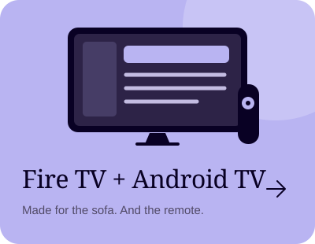
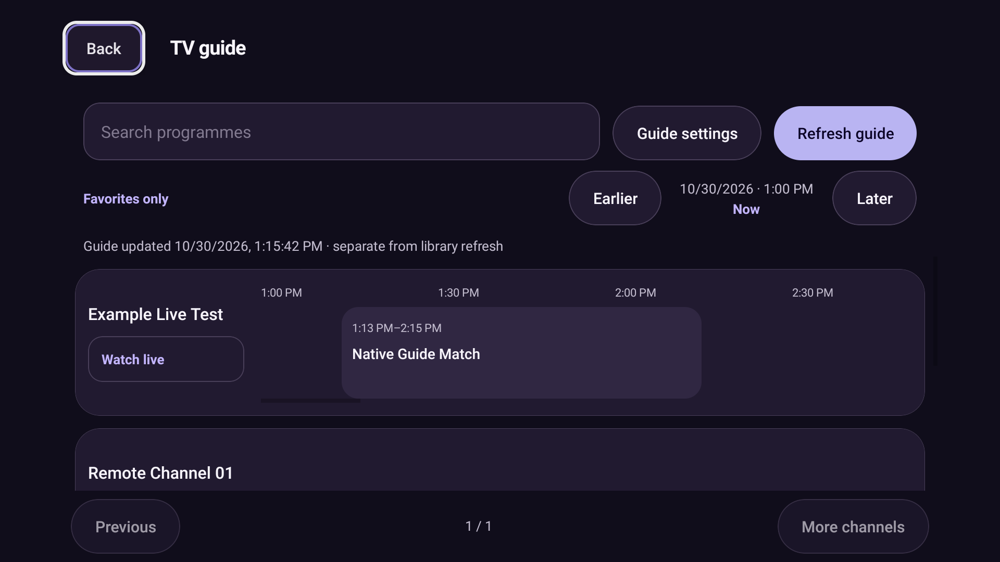

[← All editions](../README.md) · [iPhone](../iphone/README.md) · [Other Android edition](../android-mobile/README.md)

# NodeCast for Android TV

A landscape library, visible remote focus and fullscreen episodes with a bottom-right Next episode button.

**[Download TV APK · 0.6.6](https://github.com/nhshajib/NodeCast/releases/download/android-v0.6.6/NodeCast-tv-0.6.6.apk)** · [Release page](https://github.com/nhshajib/NodeCast/releases/tag/android-v0.6.6) · [Changelog](CHANGELOG.md) · [Build details & checksum](build.json)

While this repository is private, sign into GitHub with repository access before downloading.

## Version at a glance

| | Current download |
| --- | --- |
| Version | **0.6.6** · October 30, 2026 |
| File | `NodeCast-tv-0.6.6.apk` · 223.7 MB |
| Compatibility | Android 7+ · ARM32, ARM64 and x86-64 |
| App ID | `com.nhshajib.nodecast.tv` |
| Signing | Signed personal-testing APK · standard Android test key |
| Watching | No Expo Go, running PC or weekly signing renewal |
| Profiles | Local storage; no account or cloud sync |

## New in 0.6.6

TV player options open beside a persistent video surface. Returning from channel settings, display/sleep tools, playback information or track selection keeps the live session. Back closes the live track panel before leaving playback.

Connection/IP details now use the normal TV navigation window, with a compact two-column layout and direct sidebar access. Native focus highlighting avoids React state updates on each move. New panels repair focus before the next remote input; large category, media, guide and episode lists use bounded rendering. Large organization lists offer search and pages.

Existing local profiles, saved provider details, guides, favorites, PIN protection, Clear recents and **Backup & transfer** are retained. [TV stability audit](../verification/tv-stability/README.md).

**Provider-supported catch-up:** refresh your TV guide after updating, choose **Earlier**, select a completed programme, then **Watch catch-up**. Historical XMLTV data, an advertised Xtream archive and a valid provider server timezone are required. M3U catch-up templates, multiview and recording remain future work.

Preview the TV guide

 

Native Android emulator capture using synthetic channel and programme data.

## Install

1. Download the **TV APK** above on a phone or PC signed into GitHub.
2. Transfer the APK to the TV using a USB drive or a trusted file-transfer app.
3. Open the APK with a TV file manager.
4. If Android TV asks, allow **Install unknown apps** for that file manager, then choose **Install**.
5. Open **NodeCast TV** from the TV app launcher. Complete or skip the home-IP setup and add your server or playlist.
6. Use the on-screen keyboard, or your Fire TV / Google TV phone remote keyboard, to enter long server/playlist links.

Choose this APK for Fire TV / Android TV / Google TV. Samsung Tizen and LG webOS use different app formats.

## Fire TV installation

Enable installation for your file manager under **Settings → My Fire TV → Developer options → Install unknown apps** (some televisions use **Device & Software**). If Developer options is hidden, open **About**, select the device name seven times and return. Transfer and open the APK, then install it over the existing NodeCast TV app. The Hisense 50QD6QF is a Fire TV; its exact Fire OS version and physical remote behavior still need confirmation.

## Remote and Next episode

Use the D-pad to move between highlighted controls and Select/OK to activate them. Menu or long Select opens options for the focused channel, active player or library. Play/Pause and seek keys use the active player’s supported actions. **Back** closes the current page/player, clears a search or returns to Live TV before exiting.

For Xtream series, open the series and choose an episode. The fullscreen player's **Next episode** button sits at the bottom right and shows the following title/season. Select it to open that episode automatically from the beginning. It uses the provider's actual ordered episode list, crosses into the next season and releases the previous stream first. The final episode has no Next button. Plain M3U playlists without structured series metadata do not supply that sequence.

Movies and live TV keep their own playback controls. Audio/subtitle language choices for movies/episodes are remembered per profile when matching tracks are available.

## Update without losing profiles

Download the newer APK for this same edition and install it over the existing app. Avoid uninstalling first. Keep a separate copy of your provider details. An update installs new app code; it does not renew or change your IPTV subscription.

Version 0.6.6 installs over the existing TV edition and preserves profiles.

## Changelog and verification

[Read the TV changelog](CHANGELOG.md) · [Exact build record](build.json) · [Native verification](../verification/android/README.md)

Release signature, embedded JavaScript/VLC and architecture checks passed. The exact APK passed native playback, settings and stability audits on Android 11, including video pixels after menus, initial focus and actual home-IP saving/removal. Physical Hisense/provider confirmation remains necessary; API 35 emulator video was not verified. [Audit results and screenshots](../verification/tv-stability/README.md). Test your provider and hardware on your own device. Configure a private signing key before store distribution. Physical PiP still needs a device check. [Build run](https://github.com/nhshajib/NodeCast/actions/runs/41059308561).

## Build from source

Shared dependencies and provider/playback code live at the repository root. The TV interface is in `TVApp.tsx`. See the [developer guide](../docs/DEVELOPMENT.md). From the root, `npm run build:android:tv` regenerates the matching native project and builds a local Release app with the template test key. Android SDK/Java tooling is required for local compilation.

[Download help](../docs/DOWNLOADS.md) · [All editions](../README.md) · [Support NodeCast](https://buymeacoffee.com/hexorbd)
