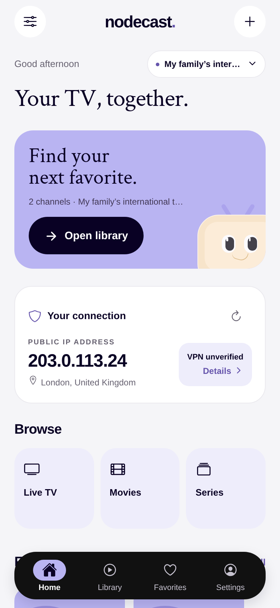
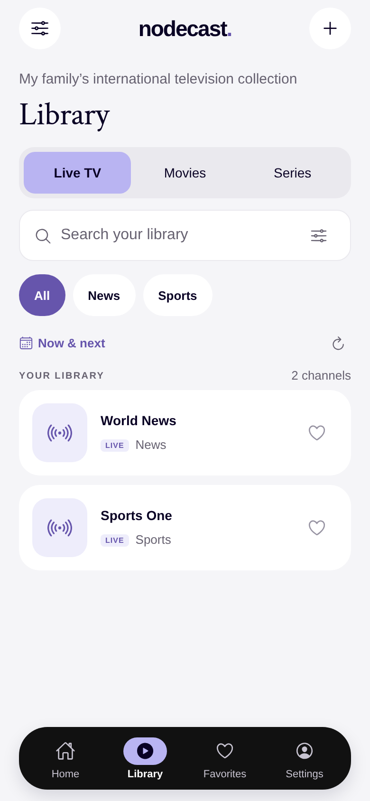
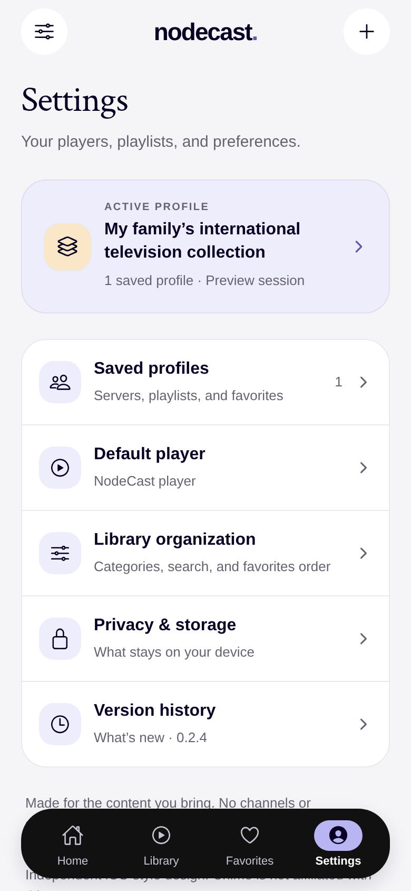
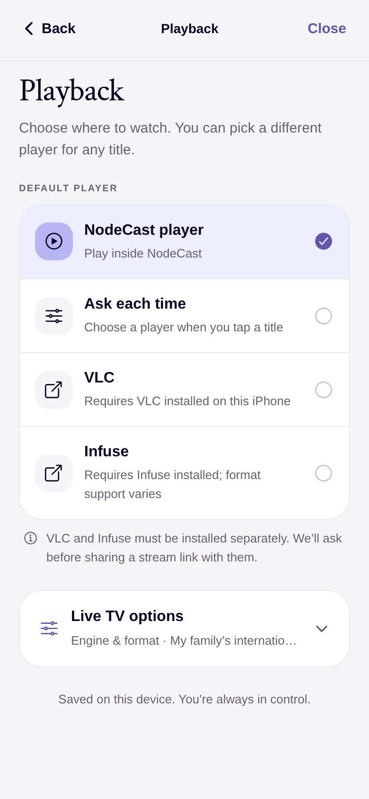
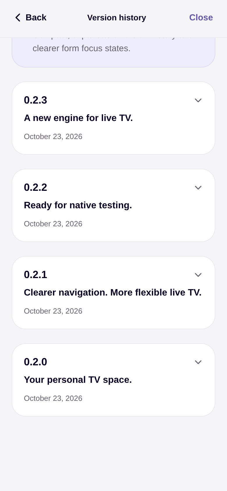
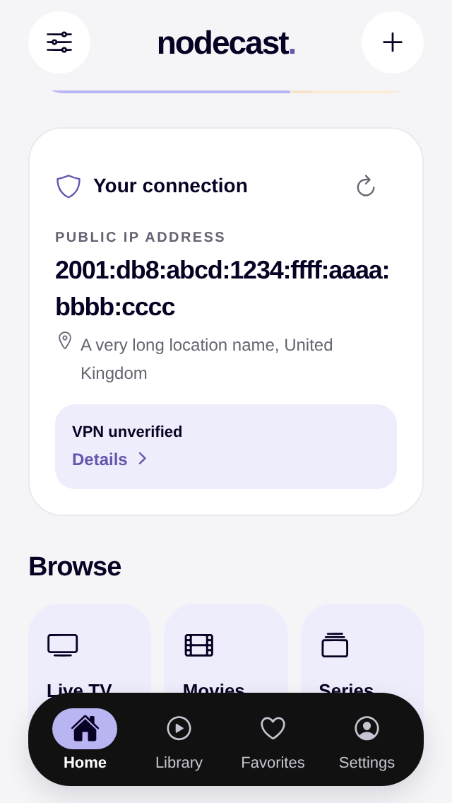

# Design audit and polish — 0.2.4

The goal is a calmer native-style iPhone experience using the supplied lavender, ink, cream and soft-gray reference palette. This is an implemented UI pass, not a claim that screenshots establish usability or native accessibility compliance.

## Findings and fixes

| Issue found | Why it felt unfinished | Implemented change |
| --- | --- | --- |
| Home heading competed with the profile pill; long names crowded the line | Weak hierarchy and fragile small-screen layout | Separate greeting/profile row, clear main heading, truncated profile pill and compact decorative hero |
| Repeated marketing copy and large cards pushed browsing down | More scrolling before useful actions | Shorter hero, compact IPv4 connection layout and direct Browse shortcuts |
| Connection card squeezed address, location, status and link together | IPv6 and long locations were difficult to read | Full-width stacked IPv6 layout; compact IPv4 row; location wraps; a single clear details target. VPN remains unverified |
| Playback exposed engine, container and external app choices together | Technical overload during a simple default-player choice | Distinct default-player group; secondary Live TV options disclosure; clear disabled native capability |
| Version history was a continuous wall of text | Hard to scan past releases | Current release expanded; older release cards expand on demand |
| Small, low-emphasis text and inconsistent sizing | More visual effort; inconsistent rhythm | Shared 34/39 heading, 19/25 section, 15/23 body and 13/20 secondary type; consistent card/input radii and spacing |
| Inputs had little focus feedback; busy primary buttons had dark spinners | Weak feedback when entering details or waiting | Persistent field labels, focus border, white busy spinner on ink, clearer disabled state |
| Many compact icon/chip targets | Harder to tap reliably | 44-point common icon/category/favorite targets, larger guide controls and readable tab labels |
| Empty Favorites/search screens gave instructions without a useful next action | A dead end when exploring or searching | Added Browse your library and Reset search actions with search-specific empty copy |
| Generic Settings identity card added little context | Consumed space without helping orientation | Tappable active-profile card with explicit profile context and a compact grouped settings list |

## Palette and contrast

The reference lavender #B9B4F2, ink #090124, cream #FAE7C8 and gray #EAE9EE remain. Darker supporting text/link tones improve readability without replacing the reference surfaces.

Computed contrast for the specific solid color pairs below:

| Pair | Ratio |
| --- | --- |
| Secondary #676271 on white | 5.90:1 |
| Secondary #676271 on app background #F5F5F8 | 5.42:1 |
| Accent #6655AC on white | 6.07:1 |
| Accent #6655AC on pale lavender #EEEDFB | 5.24:1 |
| Ink #090124 on reference lavender #B9B4F2 | 10.44:1 |

These are token checks, not a complete WCAG audit of every state, image or disabled control.

## Review gallery

Actual browser-preview captures at 390×844; compact stress captures at 320×568. IP addresses are documentation-only fixtures; provider/profile data is simulated. No real IPTV credentials appear. Browser capture does not establish physical-iPhone layout or decoder behavior.

### Home

### Live library

### Settings

### Playback

### Version history

### Compact IPv6 layout

The verification/design-polish directory also contains welcome, provider setup, movie grid/details, favorites empty state, advanced options and compact form captures.

## Validation and remaining work

TypeScript and the 65 existing behavior tests pass. Browser assertions cover focus feedback, search result count, player selection, saved format choice, unavailable-engine guidance, progressive disclosure, history expansion, narrow navigation, empty-state recovery actions and horizontal overflow. See verification/design-polish/checks.json.

Physical iPhone keyboard behavior, Dynamic Type, VoiceOver navigation, native safe-area transitions and embedded VLC are still device-test work. No new native dependency, IPA, signing, cloud account or publishing workflow is introduced by this UI pass. The planned standalone IPA workflow remains separate.
