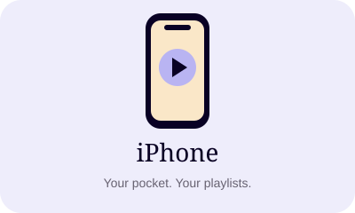
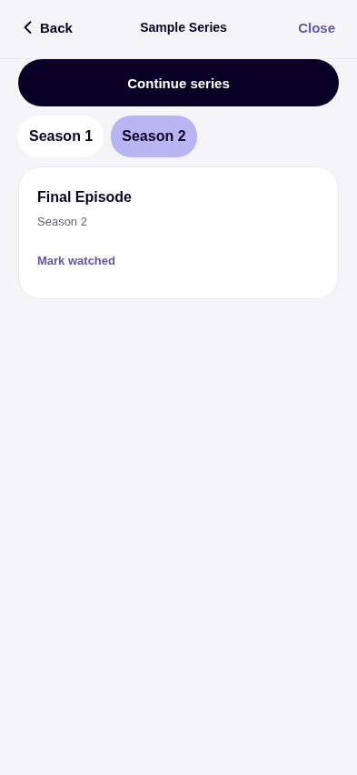

[← All editions](../README.md) · [Android mobile](../android-mobile/README.md) · [Android TV](../android-tv/README.md)

# NodeCast for iPhone

Your live channels, films and series in a calm, native iOS-style interface. Connect your own playlist, keep profiles on your device and watch with built-in playback.

**[Download IPA · 0.6.0](https://github.com/nhshajib/NodeCast/releases/download/ios-v0.6.0/NodeCast-0.6.0-unsigned.ipa)** · [Release page](https://github.com/nhshajib/NodeCast/releases/tag/ios-v0.6.0) · [Changelog](CHANGELOG.md) · [Build details & checksum](build.json)

While this repository is private, sign into GitHub with repository access before downloading.

## Version at a glance

| | Current iPhone download |
| --- | --- |
| Version | **0.6.0** · October 28, 2026 |
| File | `NodeCast-0.6.0-unsigned.ipa` · 35.8 MB |
| Device | Physical iPhone · arm64 |
| Installation | Personal signing with Impactor and your Apple account |
| Free signing | Normally renew every **7 days** |
| Watching | No running PC or Expo Go required |
| Profiles | Local device storage; no NodeCast account or cloud sync |

This is a newly compiled standalone 0.6.0 IPA with embedded JavaScript and VLC. It adds full guides, local family controls, appearance choices and focused player tools. PiP/AirPlay still need physical-device confirmation.

## New in 0.6.0

Full XMLTV guides, local family controls, Light/Dark/System, persistent mini-player, display/speed/sleep tools, local M3U import and library preferences. [Details and limits](../verification/roadmap/README.md).

## What you'll find inside

- Xtream Codes and M3U connections, named local profiles and separate favorites.
- Live TV through embedded VLC; native movie/episode playback and saved viewing progress.
- Search, categories, optional now/next guide data and library organization.
- Public IP, approximate location and an optional home-IP reference.
- VLC / Infuse handoff, remembered player preferences and available language choices.
- Animated intro, landscape/fullscreen playback, retained tab positions and Reduce Motion support.

Preview the interface

 

Browser interface capture from the iPhone navigation verification.

## Install on Windows

**Already installed NodeCast?** Load this IPA into Impactor. Keep the same Apple account and app identifier, and install over the existing app to retain profiles.

The steps below use **[Impactor (claration/impactor)](https://github.com/claration/impactor/releases)**, the installer used successfully for this setup.

1. Download the **IPA** above to your Windows PC. A direct release download is already an IPA; an Actions artifact ZIP needs extraction first.
2. Download and open **Impactor for Windows** from its official releases page. Install the required Apple device software/drivers if prompted.
3. Connect your unlocked iPhone using USB. Tap **Trust This Computer** and enter your phone PIN if asked.
4. Verify the phone appears in Apple Devices/iTunes and in **Impactor**, then select it in Impactor.
5. Add or drag `NodeCast-0.6.0-unsigned.ipa` into Impactor. Sign in with your own Apple account when prompted and start the installation. Enter credentials and verification codes only in Impactor.
6. Follow iOS prompts to trust the developer profile under **Settings → General → VPN & Device Management**. Enable **Developer Mode** under **Settings → Privacy & Security** if iOS requests it.
7. Open **NodeCast** on the phone and add your Xtream Codes details or full M3U link. Profiles from Expo Go belong to its separate app storage.

The IPA is unsigned and needs signing before it can be installed. [More Windows installation details →](../docs/SIDELOAD-WINDOWS.md)

## Renew or update

With free Apple personal signing, reconnect your phone in Impactor and refresh/re-sign before the seven-day signing period expires. Keep the same Apple account, installer/app identifier and existing installation. You can turn the PC off while watching.

If you miss renewal, the app normally stops opening until it is signed again. Re-sign over the existing app; avoid deleting it. Impactor's optional auto-refresh needs the PC and Impactor available periodically, with the phone connected through USB or supported Wi-Fi pairing. It renews signing. New NodeCast releases are separate downloads.

## Changelog and verification

[Read iPhone version history](CHANGELOG.md) · [Exact build record](build.json) · [Build run](https://github.com/nhshajib/NodeCast/actions/runs/40634579850) · [Source for this IPA](https://github.com/nhshajib/NodeCast/tree/a753597ef445e72ed2ac46323e6fb9880e9eab78)

CI checked the device architecture, embedded JavaScript, native VLC linkage and IPA integrity. Video compatibility depends on the device and provider. The IP comparison does not verify VPN status.

[Download help](../docs/DOWNLOADS.md) · [All editions](../README.md) · [Support NodeCast](https://buymeacoffee.com/hexorbd)
